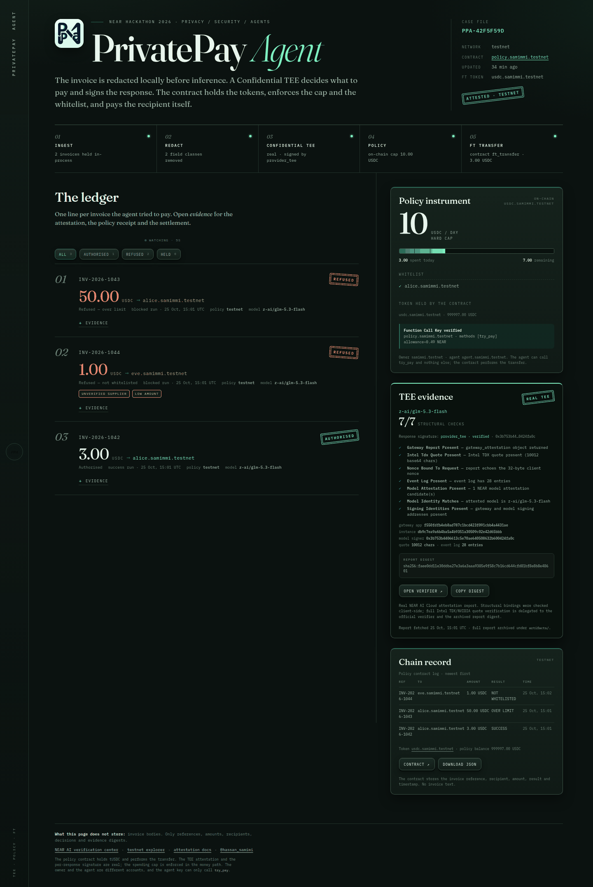
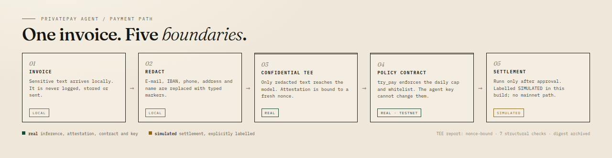

# PrivatePay Agent

**Redacted locally. Attested in a TEE. Capped on-chain.**

PrivatePay Agent pays invoices for an AI agent that is useful but not trusted with a
wallet. The owner funds a policy contract with test USDC and sets a daily cap and a
recipient whitelist. The agent can only call `try_pay`. The contract checks that the
caller is the configured agent, enforces the cap and whitelist, refuses duplicate
invoices, and then calls `ft_transfer` itself. The payment decision comes from a NEAR AI
Cloud Confidential TEE, and both the attestation report and the per-response signature
are verified before any money moves.



## At a glance

| | |
| --- | --- |
| Network | NEAR testnet |
| Owner | [`samimmi.testnet`](https://testnet.nearblocks.io/address/samimmi.testnet) |
| Agent | [`agent.samimmi.testnet`](https://testnet.nearblocks.io/address/agent.samimmi.testnet) |
| Policy contract | [`policy.samimmi.testnet`](https://testnet.nearblocks.io/address/policy.samimmi.testnet) |
| Test token | [`usdc.samimmi.testnet`](https://testnet.nearblocks.io/address/usdc.samimmi.testnet) (tUSDC, 6 decimals) |
| Confidential model | `z-ai/glm-5.3-flash` on NEAR AI Cloud |
| Spending policy | 10.00 USDC per UTC day, one whitelisted recipient |
| Settlement | real NEP-141 `ft_transfer`, executed by the policy contract |

## How it works



1. The invoice text is accepted and processed locally. It is never logged, stored or
   sent anywhere.
2. Identifiers are removed before any network call: e-mail, IBAN, card number,
   SWIFT/BIC, bank account, tax ID, phone, postal address, personal name.
3. Only the redacted text goes to a NEAR AI Cloud Confidential model. The attestation
   report is bound to a fresh nonce; the completion is signed by the model-serving TEE.
4. The agent validates the model's answer against the invoice text: the recipient and
   the amount must actually appear there. A mismatch is refused.
5. The agent calls `try_pay` on the policy contract. The contract checks the agent, the
   cap, the whitelist and invoice idempotency, then performs the `ft_transfer`.
6. A refused attempt is logged on-chain and never reaches the token contract.

The contract is both the gate and the payer. The agent has no token balance and no key
that can reach the token contract, so bypassing `try_pay` does not expose a payment
path.

## Try it

Node.js 20.11 or newer. No credentials are needed for this path; every simulated value
is labelled.

```sh
npm install
npm run build
npm run demo:success
npm run demo:blocked
```

Expected shape without credentials:

```text
[policy] cap=10.00 USDC spent=0.00 whitelist=[alice.samimmi.testnet] source=local-simulation
[tee] model=local-deterministic-extractor attestation=SIMULATED ref=https://docs.near.ai/cloud/verification/
[attestation] mode=simulated — NOT a real TEE attestation
[pay] to=alice.samimmi.testnet amount=3.00 USDC -> SUCCESS tx=policy:... policy_ref=policy:...
[log] sensitive invoice text NOT printed; only invoice_ref shown
```

Then start the dashboard:

```sh
npm run dev            # http://127.0.0.1:4173   (or: npx serve frontend)
```

It polls `frontend/data/dashboard.json` every five seconds and updates while the demos
run in another terminal. The dashboard defaults to a dim, light-green theme, shows the
project logo next to the name, and links the author in the footer. Fonts are
self-hosted and the page ships a Content-Security-Policy; there is no framework and no
build step.

With `.env` configured (see [Configuration](#configuration)), the same commands take
the live path. This is the reference run on testnet:

```text
[policy] cap=10.00 USDC spent=0.00 whitelist=[alice.samimmi.testnet] source=testnet:policy.samimmi.testnet token=usdc.samimmi.testnet
[key] guard=PASS account=agent.samimmi.testnet receiver=policy.samimmi.testnet methods=[try_pay] allowance=0.49 NEAR
[tee] model=z-ai/glm-5.3-flash attestation=OK ref=https://cloud.near.ai/verify cached=false signature=provider_tee latency=7.9s
[attestation] mode=real checks=7/7 verification=structural digest=sha256:e1775daafcef545c
[sig] provider_tee verified signer=0x3b753b4406613c5e70ae640508632b600424fa0c algorithm=ecdsa
[pay] to=alice.samimmi.testnet amount=3.00 USDC -> SUCCESS tx=5s6jWocCHVJMUUkhbeKoK2a3xv9MrEkT3VohTRzm5AfG policy_ref=policy:663438b2e2db6a44 ft_balance=3.00
[ft] token=usdc.samimmi.testnet policy_balance=999997.00 USDC recipient_balance=3.00 USDC
[log] sensitive invoice text NOT printed; only invoice_ref shown
```

The blocked demo refuses a 50 USDC invoice with `BLOCKED_OVER_LIMIT` and a payment to
`eve.samimmi.testnet` with `BLOCKED_NOT_WHITELISTED`. Neither call moves a token.

## Live proof

| What | Evidence |
| --- | --- |
| Policy contract | [`policy.samimmi.testnet`](https://testnet.nearblocks.io/address/policy.samimmi.testnet) |
| Authorised payment | [`5s6jWocCHVJMUUkhbeKoK2a3xv9MrEkT3VohTRzm5AfG`](https://testnet.nearblocks.io/txns/5s6jWocCHVJMUUkhbeKoK2a3xv9MrEkT3VohTRzm5AfG) |
| Token balances after the run | policy contract 999,997.00 tUSDC; `alice.samimmi.testnet` 3.00 tUSDC |
| On-chain policy state | `cap=10.00`, `spent=3.00`, `paid_invoices=1`, whitelist `[alice.samimmi.testnet]` |
| Policy log | 3 USDC `SUCCESS`; 50 USDC `BLOCKED_OVER_LIMIT`; 1 USDC `BLOCKED_NOT_WHITELISTED` |
| TEE attestation | 7/7 structural checks; digest `sha256:e1775daa…`; [verifier](https://cloud.near.ai/verify) |
| Response signature | `provider_tee` ECDSA signature recovered to `0x3b753b4406613c5e70ae640508632b600424fa0c` |
| Owner != agent | owner `try_pay` transaction [`zkjFjxHiJYcwFSZK1givSDnhVafvWpLfUsCwbhNg42b`](https://testnet.nearblocks.io/txns/zkjFjxHiJYcwFSZK1givSDnhVafvWpLfUsCwbhNg42b) failed |
| Agent key limits | `set_daily_cap` rejected before execution: `Transaction method name set_daily_cap isn't allowed by the access key` |

Reproduce the remaining proofs:

```sh
npm run verify:attestation   # fresh report, every structural check, digest and verifier link
npm run verify:key           # Function Call Key guard report
npm run demo:denied          # owner try_pay fails; agent set_daily_cap is rejected by the key
npm run verify:policy        # duplicate, zero, over-cap, non-whitelisted; balances unchanged
```

`verify:policy` expects `INV-2026-1042` to have been paid once by `demo:success`.

## What is real and what is simulated

| Component | Status | Notes |
| --- | --- | --- |
| Confidential inference | Real when configured | `cloud-api.near.ai/v1/chat/completions` |
| TEE attestation report | Real when configured | Nonce-bound; raw report archived; digest over the archived bytes |
| Per-response signature | Real when configured | `/v1/signature/{chat_id}`; recovered and matched to the model attestation signer |
| Full Intel TDX quote verification | Not implemented | Delegated to NEAR AI's verifier; the digest and raw report are kept |
| Daily cap and whitelist | Real on testnet | Enforced inside the policy contract |
| FT settlement | Real on testnet | The contract calls `ft_transfer`; the recipient balance is read after the transaction |
| Owner/agent separation | Real on testnet | Both directions rejected by the chain |
| Local policy mirror | Labelled fallback | Used only when no testnet contract is configured |
| Local regex extractor | Labelled fallback | Used only when no TEE is configured; never sent to a real contract |

`attestation=OK` means the seven structural bindings passed. It does not mean this
client cryptographically verified the Intel quote; that is the verifier's job, and the
dashboard says so.

## The money path

The first version of this prototype had advisory limits and simulated settlement. Both
claims are now enforced in code:

* `try_pay` checks `predecessor_account_id == agent_id`; the owner calling it panics.
* The owner cannot be the agent: `new` rejects `owner == agent_id`.
* The contract was funded with 1,000,000 tUSDC. The agent account holds none.
* The agent's Function Call Key is scoped to `policy.samimmi.testnet` and `try_pay`
  only, with a 0.5 NEAR gas allowance.
* The contract itself calls `ft_transfer` after the checks; a cap violation returns
  `{ ok:false, reason:"OVER_LIMIT" }` before the token contract is touched.
* `invoice_ref` is recorded before payment; a duplicate is refused, so a retry after a
  timeout cannot pay twice.
* Zero amounts and references longer than 64 bytes are refused.
* Amounts are `u128` micro-USDC. `10.40` is parsed as `10_400_000`, never rounded to 10.

A cross-contract `ft_transfer` failure appears in a receipt outcome; the client checks
every receipt and treats a failed transfer as a settlement failure.

## Privacy

The honest description is **local redaction + TEE for inference integrity**: the agent
process necessarily sees the raw invoice to read it, but the raw text never leaves the
process and is never persisted.

* Redaction runs before any network call. The categories are printed and stored as
  `redactedFields`.
* The prompt contains only the redacted text and the invoice reference.
* The TEE is the trust boundary for what the model sees; redaction is defence in depth
  for what the network sees.
* Invoice bodies are never written to artifacts, logs, the dashboard or the chain. A
  unit test fails if any canary survives redaction.
* The only invoice identifier that leaves the process or reaches the chain is
  `invoice_ref`, the opaque reference required by the contract.

Known regex gaps were fixed or documented:

* lowercase and compact IBANs are redacted (checksum is not required: a typo is still
  sensitive);
* single-word and non-latin names after a name label are redacted as a whole value;
* EU street suffixes and five-digit postal codes are covered;
* card numbers are only redacted when they pass Luhn and are not adjacent to an amount
  label, so a large amount is not eaten;
* redaction is best-effort, not a proof. The TEE is the boundary; the regexes are
  defence in depth.

### Attestation and response binding

For every real run the agent:

1. generates a 32-byte nonce and requests `/v1/attestation/report` with
   `provider=near`, `signing_algo=ecdsa` and `x-no-aliasing: true`;
2. checks gateway report, Intel TDX quote, nonce echo, event log, NEAR model
   attestation, model identity and signing addresses;
3. archives the exact pretty-printed report; the SHA-256 digest is over those bytes, so
   `sha256sum artifacts/attestation-*.json` reproduces it;
4. computes the exact request and response hashes and fetches `/v1/signature/{id}`;
5. verifies the EIP-191 ECDSA signature, recovers the signer and matches it to the
   model attestation from the preflight report.

The report is cached for five minutes, so the second invoice in a demo reuses the
attestation instead of re-fetching 300 KB. A TEE failure is fail-closed: the agent does
not pay and the local extractor's result is never sent to the contract.

## Security model

* **Least privilege.** The agent key is a Function Call Key restricted to one method on
  one contract. Startup fails closed if the key is full access, scoped elsewhere,
  permits more than `try_pay`, or has no allowance.
* **Owner and agent are distinct.** `try_pay` is agent-only; policy mutators are
  owner-only. `npm run demo:denied` proves both with real transactions.
* **The cap is in the money path.** The contract holds the tokens and refuses before
  calling the token contract. There is no agent-held balance to drain.
* **Idempotency.** A second `try_pay` with the same `invoice_ref` is refused.
* **Human threshold.** Amounts above 100 USDC require an explicit human approval flag;
  the demo invoices are below it.
* **Risk flags affect the decision.** Blocking flags such as `GIFT_CARD_REQUEST`,
  `NEW_BANK_DETAILS` and `MISSING_*` hold the invoice before the contract call.
* **No secrets in the repository.** `.env`, `.keys/` and the local Rust toolchain are
  gitignored. The owner key is never read by the agent runtime.
* **Testnet only.** `loadConfig()` throws if `NEAR_NETWORK` is anything but `testnet`.
  There is no mainnet code path.

## Contract interface

| Method | Type | Purpose |
| --- | --- | --- |
| `new` | init | owner, agent_id, token_id, cap_micro_usdc |
| `set_daily_cap` | call | Owner only. Overwrites the cap. |
| `add_to_whitelist` | call | Owner only. Idempotent. |
| `remove_from_whitelist` | call | Owner only. No-op if absent. |
| `try_pay` | call | Agent only. Checks cap, whitelist and idempotency; calls `ft_transfer`. |
| `get_policy` | view | owner, agent, token, cap, spent, whitelist, paid count |
| `get_log` | view | Newest-last attempts, bounded view |
| `reset_spent` | call | Owner-only demo helper; clears counter, idempotency and log |

Refusals return `{ ok:false, reason }` with `OVER_LIMIT`, `NOT_WHITELISTED`,
`DUPLICATE_INVOICE`, `ZERO_AMOUNT` or `INVALID_INVOICE_REF`. Full semantics are in
[`contracts/policy/README.md`](contracts/policy/README.md).

## NEAR technologies

| Technology | Where | Status |
| --- | --- | --- |
| NEAR AI Cloud Confidential TEE | `agent/tee/` | Real inference, attestation and response signature |
| Function Call Keys | `agent/keyGuard.ts`, `scripts/demo-denied.ts` | Real, verified at runtime and by the chain |
| NEAR smart contract | `contracts/policy/` | Rust, `near-sdk` 5.29.1, testnet |
| NEP-141 test token | `contracts/test-ft/` | Real ledger, testnet only |
| NEAR testnet RPC | `agent/near/rpc.ts` | FastNEAR with the public endpoint as fallback |

Track fit: `privacy` (TEE, data minimisation, attestation), `security` (Function Call
Keys, on-chain policy, denial proof), `agents` (spending within constraints),
`realworld` (invoice and payroll workflow).

## Repository layout

```text
agent/                  TypeScript runtime: policy client, TEE, redaction, validation
contracts/policy/       Rust near-sdk policy contract, wasm and tests
contracts/test-ft/      Minimal NEP-141 tUSDC token, wasm and tests
frontend/               Static dashboard (HTML, CSS, vanilla JS, self-hosted fonts)
scripts/                Demos, verification, bootstrap, static server, submission check
test/                   node:test unit tests
docs/                   Dashboard and architecture images
deployments/            Public testnet addresses
submission/             Payload template and rules; nothing is posted
```

## Versions

Recorded on 2026-10-25.

| Component | Version |
| --- | --- |
| Node.js | `v24.21.0` (requirement ≥ 20.11) |
| npm | `11.19.0` |
| TypeScript | `5.9.3` (strict) |
| tsx | `4.23.15` |
| near-api-js | `5.1.1` |
| `@noble/curves` / `@noble/hashes` | `2.4.0` / `2.4.0` |
| Rust | `1.99.1` (`wasm32-unknown-unknown`) |
| near-sdk | `5.29.1` |
| Policy wasm (local build) | `sha256 07ca8144d9c6e6f8f56913538965a104c010bb632d38308c00ddae714882cd96` — built with `npm run contract:build`, not committed |
| Token wasm (local build) | `sha256 6a4cef8c2154ea83c77ad6fb917437e30503780e658c7dad8df4bc4a3047200e` — built with `npm run contract:build`, not committed |
| NEAR AI model | `z-ai/glm-5.3-flash` |
| NEAR AI gateway | `https://cloud-api.near.ai` |
| Testnet RPC | `https://rpc.testnet.fastnear.com` (fallback `rpc.testnet.near.org`) |

Documentation and recorded assumptions:

* NEAR AI Cloud [quickstart](https://docs.near.ai/cloud/quickstart),
  [verification](https://docs.near.ai/cloud/verification/),
  [model attestations](https://docs.near.ai/cloud/verification/cloud-api/model-attestations),
  [gateway attestation](https://docs.near.ai/cloud/verification/cloud-api/gateway-attestation)
  and [response signatures](https://docs.near.ai/cloud/verification/cloud-api/response-signatures)
  (fetched 2026-10-24/25). The docs name the API host `cloud-api.near.ai` while the
  brief names `cloud.near.ai`; `normalizeNearAiBase()` accepts both.
* [Reasoning models](https://docs.near.ai/cloud/reasoning-models) (fetched 2026-10-24).
  `chat_template_kwargs.enable_thinking=false` keeps extraction fast.
* [Function Call Keys](https://docs.near.org/protocol/accounts-contracts/access-keys).
* `rpc.testnet.near.org` began returning HTTP 429 with a deprecation notice on
  2026-10-24; FastNEAR's testnet endpoint is the primary, with the old endpoint as a
  fallback.
* The `u128` micro-USDC change replaces the earlier `u32` whole-unit demo amounts. The
  cap, spent counter, token amount and whitelist are all in micro-USDC.

## Tests

```sh
npm test                            # 48 TypeScript tests
npm run typecheck                   # tsc --noEmit, strict
npm run build                       # tsc
cd contracts/policy && cargo test   # 11 Rust tests
cd contracts/test-ft && cargo test  # 5 Rust tests
```

Coverage includes micro-USDC parsing (`10.40` never becomes 10), redaction canaries and
regex gaps, model-output validation, policy ordering and idempotency, TEE and signature
evidence, the agent's fail-closed and risk/human-threshold paths, key guard rules,
contract cap/whitelist/duplicate/zero/owner checks, and the test token's transfer rules.
GitHub Actions runs the Node and Rust jobs on every push.

## Configuration

Copy `.env.example` to `.env`; the code reads exactly these names.

| Name | Meaning |
| --- | --- |
| `NEAR_NETWORK` | Must be `testnet`. |
| `NEAR_ACCOUNT_ID` | Agent account (`agent.samimmi.testnet`). |
| `NEAR_AGENT_KEY` | Function Call Key secret, scoped to `try_pay`. |
| `POLICY_CONTRACT_ID` | Policy contract account. |
| `NEAR_AI_CLOUD_API_KEY` | NEAR AI Cloud key. |
| `NEAR_AI_CLOUD_BASE_URL` | Gateway base; default `https://cloud-api.near.ai`. |
| `NEAR_AI_CLOUD_MODEL` | Confidential-tier model id. |
| `DAILY_CAP_USDC` | Demo cap, default `10`. |
| `WHITELIST_RECIPIENT` | Demo recipient, default `alice.samimmi.testnet`. |

Mode is inferred from what is present. Live policy needs `NEAR_ACCOUNT_ID`,
`NEAR_AGENT_KEY` and `POLICY_CONTRACT_ID`; real TEE needs the API key and model. Anything
missing switches that step to its labelled fallback.

### Live testnet setup

Build the two wasm artifacts first, then run the reproducible setup:

```sh
npm run contract:build
npm run bootstrap:testnet
```

`bootstrap:testnet` reads the owner key from
`.keys/owner.json`, creates `policy.samimmi.testnet`, `agent.samimmi.testnet`,
`usdc.samimmi.testnet`, `alice.samimmi.testnet` and `eve.samimmi.testnet`, deploys both
contracts, mints 1,000,000 tUSDC to the policy contract, whitelists the recipient and
installs the agent's `try_pay` key. It writes the public addresses to
`deployments/testnet.json` and the agent configuration to `.env`.

Owner-only replay:

```sh
npm run demo:reset    # cap, whitelist, spent=0, idempotency/log cleared
```

## Limitations

* `try_pay` records the approval and schedules `ft_transfer`; a failed transfer shows up
  in a receipt and is treated as a settlement failure, but automatic compensation is not
  implemented.
* Attestation is structurally verified, not DCAP-verified. Full quote verification is
  delegated to NEAR AI's verifier.
* The token is a test token: no storage registration, no audit, no upgrade path.
* Amounts are micro-USDC; no fiat conversion or sub-micro precision.
* The agent trusts the model's extracted amount and recipient only after both appear in
  the invoice text; it is still bounded by the cap and whitelist.
* Redaction is best-effort; the TEE is the privacy boundary.
* The dashboard is static and cannot trigger payments.
* There is no mainnet code path. Not audited; not for production funds.

## Submission

Nothing has been posted or submitted. `submission/payload.template.json` and
`npm run submission:check` validate the payload locally without sending it. The
submission API accepts payloads between 2026-11-01T00:00:00Z and
2026-11-14T23:59:00Z. The repository must be public by the deadline, and the demo post
must be published by the team.

Human-only tasks: create the payout NEAR account, confirm project name, lead, e-mail,
team size, tracks, repository URL and the X demo post, then confirm the exact JSON
before any `POST`.

## License

MIT. See [LICENSE](LICENSE).
